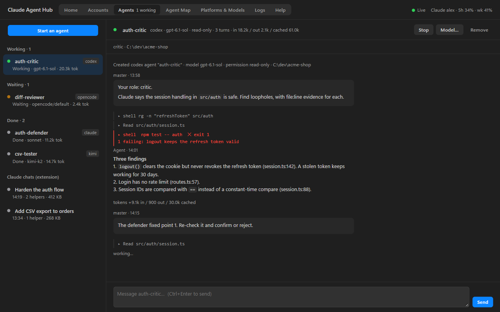
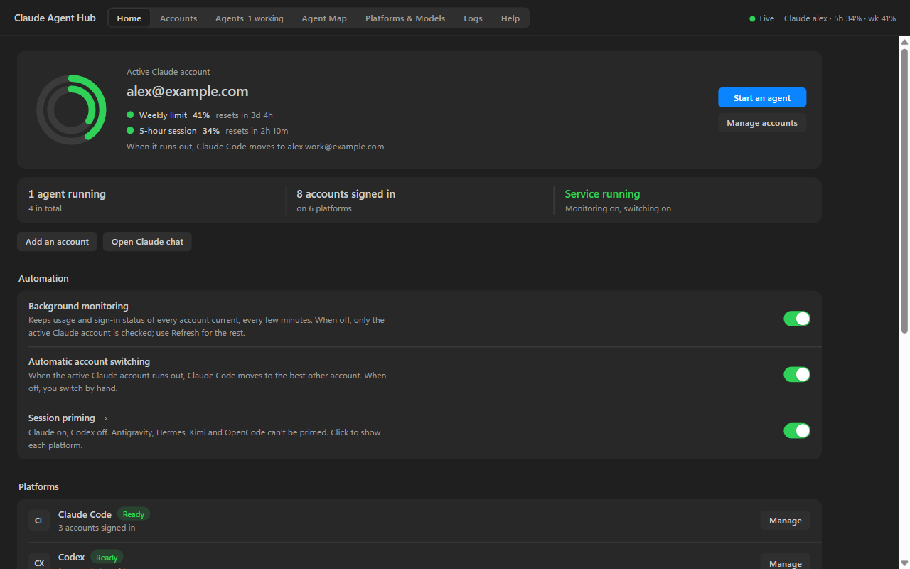
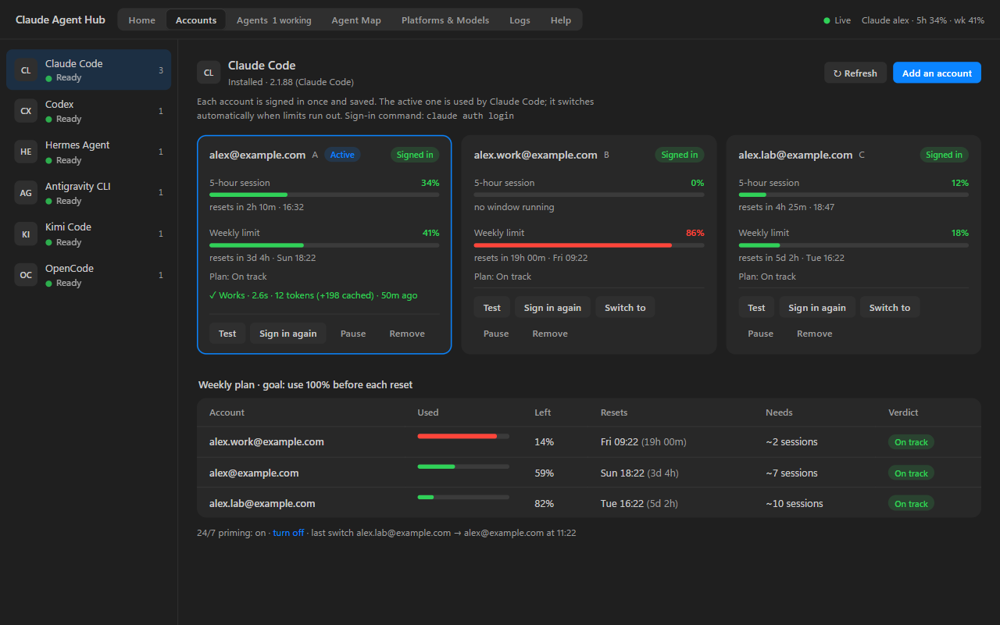
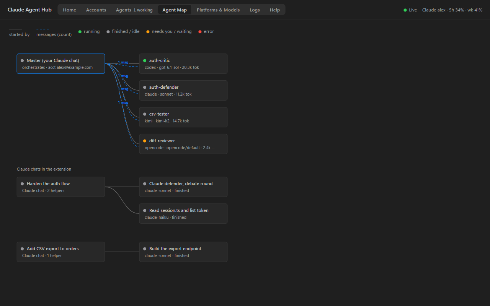

<div align="center">

# Claude Agent Hub

**Let Claude orchestrate Codex, Kimi, Hermes, OpenCode and Antigravity agents, and watch every one of them work, live, inside your IDE.**

Multi-agent debates, build-and-test loops and code reviews, with one dashboard for every agent's conversation, commands and token use, and for every account's 5-hour and weekly usage limits.

[](https://github.com/Anreddykarthikreddy3003/Claude-agent-hub/actions/workflows/ci.yml)
[](LICENSE)




</div>

## Why

Claude Code is great at one conversation. Real work often wants more than one opinion: a second model to attack a design, a tester that uses the app like a person, a reviewer that reads the diff. Doing that by hand means juggling terminals, copying replies between them and losing track of who said what.

Claude Agent Hub makes **your Claude Code chat the master**. You describe the setup in plain words, Claude starts the agents, relays their messages, checks their claims and gives you a verdict. You watch everything in a dashboard tab next to your code.

```text
/duo Claude says the session handling in src/auth is safe. Codex must find loopholes
     with file:line evidence. 2 rounds, then you decide.
```

## Features

**Multi-agent orchestration**
- Claude runs **OpenAI Codex, Kimi Code, Hermes Agent, OpenCode and more Claude agents** as helpers, in any arrangement: debate, build and test, review, second opinion. No fixed workflows.
- Each agent keeps its own session, so it remembers earlier rounds.
- Per-agent model choice (Codex defaults to `gpt-6.1-sol`). Ask for a model that doesn't exist and you get the list of models that do.
- Per-agent permissions: read-only for debate and review, workspace write for building and testing.

**A live dashboard inside VS Code and Antigravity**
- **Agents:** every agent's conversation, each command it ran (failed ones in red), each file it changed, and its tokens. Type to any agent directly.
- **Agent Map:** who started whom and who messaged whom, plus your Claude chats and their sub-agents.
- **Accounts:** usage bars and reset times for every account on every platform, a Test button that sends the cheapest possible message, and sign-in from the dashboard.
- **Platforms & Models, Logs and Help** tabs, and a color-graded status bar summary on hover.

**Built to survive long jobs**
- One turn at a time per agent; extra messages queue.
- Hits a usage limit? Claude agents continue on another of your accounts; other agents wait and resume by themselves.
- IDE or service restart? The interrupted turn continues. A lost session restarts with a capped recap of the work so far.
- No output for 15 minutes counts as a stall and the whole process tree is stopped.

**Token discipline**
- The master never reads raw streams: it gets the last reply (capped), counts and a transcript path.
- Token use is recorded per agent and per turn and shown everywhere.

**Usage limits and accounts**
- Tracks the **5-hour session and weekly limit** of every Claude account, with exact reset times (the same numbers `/usage` shows), plus Codex and Antigravity quotas.
- If you have more than one Claude account (for example personal and work), Claude Code can move to the best one automatically when the active one runs out, or you can switch, hold or pause an account by hand.
- A weekly plan shows how much of each account is left before it resets.

<table>
  <tr>
    <td></td>
    <td></td>
  </tr>
  <tr>
    <td align="center">Home</td>
    <td align="center">Accounts and weekly plan</td>
  </tr>
  <tr>
    <td colspan="2"></td>
  </tr>
  <tr>
    <td colspan="2" align="center">Agent Map</td>
  </tr>
</table>

## Supported agents

| Platform | Run as an agent | Accounts and usage | Notes |
|---|---|---|---|
| Claude Code | ✅ | ✅ 5-hour and weekly | Helpers use the active account |
| OpenAI Codex | ✅ | ✅ 5-hour and weekly | Needs Codex CLI 0.160 or later |
| Kimi Code | ✅ | sign-in status | Needs a plan that includes Kimi Code |
| Hermes Agent | ✅ | sign-in status | |
| OpenCode | ✅ | sign-in status | |
| Antigravity CLI (`agy`) | opens in a terminal | ✅ quota | `agy --print` doesn't run in the background yet |

## Requirements

- **Windows 10 or 11.** The background service uses Windows Task Scheduler and Antigravity logins use Windows Credential Manager. macOS and Linux aren't supported yet; contributions are welcome.
- **Node.js 20+** and **Claude Code** (CLI or the VS Code / Antigravity extension).
- Optional: the CLIs of the agents you want to run (`codex`, `kimi`, `hermes`, `opencode`, `agy`).
- No npm dependencies.

## Quick start

```powershell
git clone https://github.com/Anreddykarthikreddy3003/Claude-agent-hub.git
cd Claude-agent-hub
node bin/cam.mjs install
```

`install` sets up, in one step:
- a background service (a hidden Windows scheduled task that checks every 5 minutes),
- the Claude Code plugin: hooks, slash commands and MCP tools,
- the dashboard extension for VS Code and Antigravity,
- the Claude Code status line and a `cam` command for terminals.

Save the Claude account you're signed in to, and any others:

```powershell
cam accounts import A      # the account Claude Code is using now
cam accounts add B         # opens a sign-in window for another account (optional)
```

Reload the IDE window, then open **Claude Agent Hub** from the Activity Bar, the editor title button or the status bar. Run `cam doctor` to check the setup.

Other platforms sign in from the dashboard: **Accounts → pick a platform → Add an account**.

## Usage

Talk to Claude in your normal chat. Mentioning another agent is enough; `/duo` makes it explicit.

```text
/duo Claude builds the CSV export. Codex tests it as a real user: no test scripts,
     run the app and try normal, edge and wrong inputs. Loop until it passes, max 3 rounds.

/duo Ask Codex to review my uncommitted changes. Claude fixes what it finds.

Start a Kimi agent to write tests for src/billing while Claude refactors it.
```

Long findings and the master's verdict are saved to `<project>/.duo/`. Add `.duo/` to your project's `.gitignore` if you don't want to commit them.

### Slash commands

Plugin commands can also be typed with the plugin prefix, for example `/claude-agent-hub:duo`.

| Command | What it does |
|---|---|
| `/duo <setup>` | Run agents together in any arrangement you describe |
| `/accounts` | All Claude accounts: usage, resets, which one is next |
| `/accounts add\|remove\|pause\|resume\|relogin <name>` | Manage an account |
| `/switch-account [name]` | Switch Claude Code now (no name means the best account) |
| `/week` | Weekly plan for every account |
| `/ready on\|off` | Session priming on or off (see below) |

### CLI

```text
cam accounts                     all accounts, usage, resets, next switch
cam switch [name] [--force]      switch now; --force holds an account until it reaches 100%
cam week                         weekly plan
cam refresh                      fetch live usage now
cam log [n]                      recent switches, primes and alerts
cam doctor                       check that everything works
cam uninstall [--purge]          remove everything (--purge also deletes saved logins)
```

### MCP tools

The plugin gives Claude these tools: `agent_start`, `agent_send`, `agent_read`, `agent_list`, `agent_stop`, `agent_retry`, `agent_set_model`, `models_list`, `account_status`, `best_account`, `switch_account`, `weekly_plan`, `set_priming`, and `codex_ask` / `codex_continue` for quick one-off Codex questions.

## Configuration

Settings live in `%USERPROFILE%\.claude-accounts\config.json`. Most can be changed from the dashboard's Home tab.

| Key | Default | Meaning |
|---|---|---|
| `autoSwitch` | `true` | Move Claude Code to the best account when the active one runs out |
| `monitoring` | `true` | Keep usage of every account current in the background |
| `sessionSwitchAt` | `95` | Switch away at this 5-hour usage % |
| `weeklyStopAt` | `98` | Stop using an account at this weekly usage % |
| `ready` | `false` | Session priming for Claude accounts (opt in) |
| `primeCodex` | `false` | Session priming for Codex plans with a 5-hour window |
| `notifications` | `true` | Windows notifications for alerts |

**Session priming** sends a one-word message (about 240 tokens) when an account's 5-hour window has ended, so the next window starts counting earlier. It's off by default. Read the next section before turning it on.

## Terms of service

This project is not affiliated with, endorsed by or supported by Anthropic, OpenAI, Google, Moonshot AI, Nous Research or the OpenCode project. You are responsible for following each provider's terms.

- Anthropic has said that having more than one Claude account is not against its terms. **Using several accounts to get around usage limits, or sending automated messages, may be.** Account switching and session priming are tools for people with legitimately separate accounts; you use them at your own risk.
- Usage numbers come from the same endpoint Claude Code's `/usage` uses. It isn't a documented public API and may change.

## Privacy and security

- Everything runs on your computer. There is no telemetry and no server of ours.
- Network calls go only to the providers you use: Anthropic's usage and profile endpoints, ChatGPT's usage endpoint for Codex, Google's quota endpoint for Antigravity, plus whatever the agent CLIs themselves call.
- Saved Claude logins are stored in `%USERPROFILE%\.claude-accounts\slots\`, the same way Claude Code stores its own login. Antigravity logins stay in Windows Credential Manager.
- The dashboard talks to the local service on `127.0.0.1` with a random bearer token.

See [SECURITY.md](SECURITY.md) to report a vulnerability.

## How it works

```text
VS Code / Antigravity
 ├─ Claude Code (your chat = the master)
 │    └─ plugin: hooks + MCP tools (agent_*, accounts)
 └─ Claude Agent Hub extension: dashboard + status bar
          │  HTTP + SSE on 127.0.0.1, bearer token
          ▼
 background service (one per user)
   ├─ accounts: usage polling, switching, optional priming
   └─ hub: agent registry, turn runner, limit queue, API
```

Each message to an agent is one turn: the service starts that platform's CLI headless with session resume, normalizes its JSON stream into events and stores them on disk. Details are in [docs/ARCHITECTURE.md](docs/ARCHITECTURE.md).

## FAQ

**Is this an official Anthropic product?** No. It's an independent open-source project built on Claude Code's public plugin system.

**Does it need an API key?** No. Each agent uses the subscription or login you already have for it.

**Does it work in Cursor or plain VS Code?** The dashboard is a standard VS Code extension, so it should work in VS Code forks. Install `dist/claude-agent-hub.vsix` by hand if `cam install` doesn't find your editor.

**Can I use only the agent features and ignore account switching?** Yes. With one account, switching simply never happens; turn it off with the Home tab switch or `"autoSwitch": false`.

## Contributing

Bug reports, platform adapters and macOS/Linux support are very welcome. See [CONTRIBUTING.md](CONTRIBUTING.md). Please follow the [Code of Conduct](CODE_OF_CONDUCT.md).

## License

[MIT](LICENSE)
